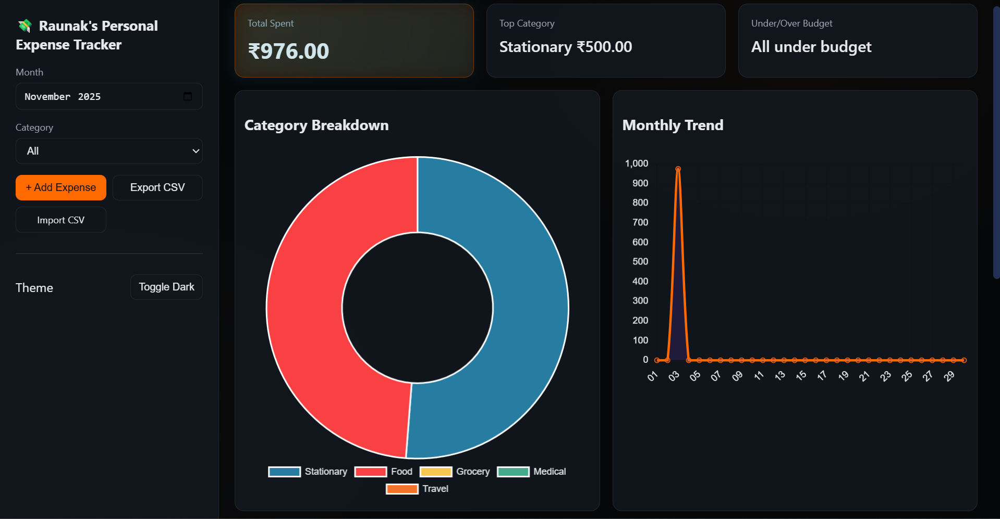
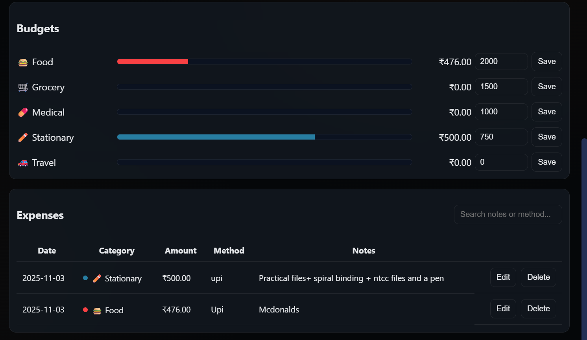

# Daily Expense Tracker

A full-stack web app I built to manage my daily expenses, because I wanted something better than the usual Excel or Google Sheets. Log expenses, sort them into categories, set monthly budgets, and see where the money goes on a live dashboard.




## Features

- **Add, edit and delete expenses** with date, amount, category, payment method and notes
- **Dashboard** for any month: total spent, top category and budget status
- **Charts** (Chart.js): category breakdown doughnut and daily spending trend
- **Monthly budgets per category** with a progress bar for each
- **Real-time updates** over Socket.IO, so every open tab refreshes when an expense changes
- **CSV import and export** (`date,amount,category,notes,payment_method`)
- **Filters and search** by month, category and free text
- **Dark mode**, plus an installable PWA (manifest + service worker)
- Default categories: Food, Travel, Medical, Stationary, Grocery

## Tech stack

| Layer | Tech |
|---|---|
| Backend | Node.js, Express, Socket.IO, Helmet, Morgan |
| Database | SQLite via `better-sqlite3` (WAL mode) |
| Frontend | Vanilla JS, HTML, CSS, Chart.js |

## Run it

Requires Node.js 18+.

```bash
git clone https://github.com/Ron2509/Daily-Expense-Tracker.git
cd Daily-Expense-Tracker
npm install
npm start
```

Open http://localhost:3000. The SQLite database (`expense_tracker.db`) is created on first run.

## API

| Method | Endpoint | Purpose |
|---|---|---|
| GET / POST | `/api/expenses` | List (`?from=&to=&categoryId=`) / create |
| PUT / DELETE | `/api/expenses/:id` | Update / delete |
| GET / POST | `/api/categories` | List / create |
| GET / POST | `/api/budgets` | List / set a category's monthly limit |
| GET | `/api/analytics/summary?month=YYYY-MM` | Totals, per-category, per-day and budget usage |
| POST | `/api/import` | Import CSV (`{ csv: "..." }`) |
| GET | `/api/export` | Download all expenses as CSV |

## Status

Still in development.
